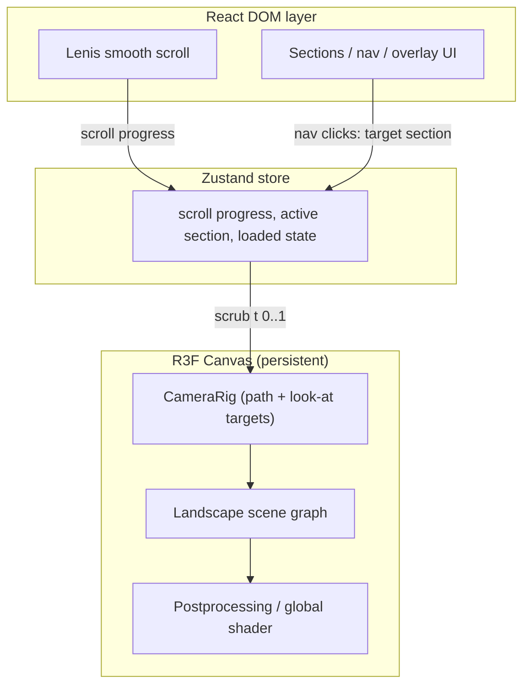

# Implementation Plan: 3D Landscape Website

A scroll-driven, 3D-first studio site in the spirit of basement.studio — but with **your own landscape and identity**.

> **Rule of thumb:** borrow the *architecture*, never the *art direction*. Basement's edge is their scene art + shaders + motion choreography. Studying their open-source code is fine; the landscape, palette, typography, and copy must be yours.

---

## 1. Anatomy of basement.studio (what you're replicating)

Basement's site is open source ([github.com/basementstudio/website-2k25](https://github.com/basementstudio/website-2k25)), which makes it the best reference available. Key facts:

- **One persistent 3D scene** rendered behind/around the DOM content. Navigation doesn't load a new page — it flies the camera to another spot in the same scene.
- The landscape is **not one giant model**: it's a composed scene (terrain, props, buildings) with **baked lightmaps** (no real-time shadows), plus a **custom global GLSL shader** that applies grading/fog across the scene.
- **Scroll and nav both drive camera animation** between "areas" that map to site sections (home, showcase, services, etc.).
- Extras (games, pets, inspectable objects) are layered on top of the same scene graph.

So "a website like basement.studio" = *a small 3D world + a camera choreography system + conventional web content floating over it.*

---

## 2. Recommended Tech Stack

| Layer | Choice | Why |
| --- | --- | --- |
| **Framework** | Next.js (App Router) + TypeScript | Same choice as basement; R3F-friendly, static export possible, great DX |
| **3D engine** | three + @react-three/fiber + @react-three/drei | Declarative Three.js; the entire ecosystem (postprocessing, rapier, etc.) builds on it |
| **Postprocessing** | @react-three/postprocessing (or basement's `@basementstudio/shader-lab`) | Bloom, DOF, grain, vignette — the "film look" |
| **Scroll / motion** | Lenis (smooth scroll) + GSAP ScrollTrigger (camera timeline) + Motion for UI | Scroll drives a GSAP timeline that scrubs camera position along a path |
| **3D assets (if modeling)** | Blender → glTF + Draco + KTX2 textures | Industry standard pipeline; basement does exactly this |
| **State** | Zustand | Lightweight; basement uses it to bridge DOM ↔ 3D state |
| **Styling** | CSS Modules + design tokens in CSS custom properties | Zero runtime, zero dependencies, fully custom art direction (see §2.1) |
| **CMS / content** | Sanity (or Basehub) — or plain MDX to start | Sections, blog posts, showcase entries editable without deploys |
| **Backend needs** | Minimal: server actions / API routes for contact form + email (e.g. Resend), optional newsletter | A studio site is 95% static; don't build a real backend until needed |
| **Analytics** | Vercel Analytics or PostHog | Lightweight, privacy-friendly |
| **Hosting** | Vercel (or Netlify) | Zero-ops, edge CDN, preview deploys |
| **Dev tooling** | ESLint, Prettier, `r3f-perf` (in-dev FPS/draw-call meter), git LFS for heavy assets | Keep 3D perf visible during development |

**Backend reality check:** the "backend" for this site is mostly a CDN. Content comes from the CMS, the contact form is one serverless function, and everything else is static assets. Spend your effort on the frontend and the scene, not on servers.

### 2.1 Styling: CSS Modules + CSS custom properties (no Tailwind)

Utility CSS fights you on art-directed sites anyway — this project needs bespoke layout, typography, and scroll-linked animation, not utility classes.

**Structure:**

- **`styles/tokens.css`** (global, imported once in the root layout): the entire design system as CSS custom properties — palette, type scale (`--font-display`, `--step-0…--step-6`), spacing rhythm, z-index layers (`--z-canvas`, `--z-content`, `--z-nav`), easing curves, breakpoints. This file *is* the brand, mirroring the shader palette.
- **CSS Modules** per component (`Hero.module.css`, `Nav.module.css`) — scoped class names, colocated with components, zero runtime cost.
- **`styles/base.css`**: a modern reset (`@layer reset, base, components, utilities`) — native cascade layers avoid specificity wars.
- **Modern CSS does the heavy lifting:** `clamp()` fluid type, container queries, `color-mix()`, `:has()`, grid/flexbox. Nothing that needed a preprocessor or utility framework in 2019 still does in 2026.

**Why not the other candidates:**

| Alternative | Verdict |
| --- | --- |
| Sass/SCSS | Fine, but modern CSS covers ~95% of it; adds a build step for little gain |
| vanilla-extract / PandaCSS | Type-safe CSS-in-TS; good libraries, but overkill for a single art-directed site and their APIs slow down freeform design iteration |
| styled-components / Emotion | Runtime cost and SSR friction in App Router; legacy choice now |

If you later miss type-safety on tokens, generate TypeScript constants from `tokens.css` in a build step — but start with the plain CSS setup; it's the least machinery that fully does the job.

---

## 3. Creating Your Own Landscape — Three Routes

### Route A — Procedural terrain (100% code)

Generate the terrain in the browser from noise. No DCC software needed.

1. **Heightfield:** layer Simplex/Perlin noise (FBM — 4–6 octaves) on a large `PlaneGeometry` (e.g. 256×256 segments). Libraries: `simplex-noise` npm package, or implement FBM in a GLSL vertex shader and displace vertices on the GPU.
2. **Shaping:** apply *domain warping* (warp the noise input by another noise) to get natural, non-generic ridges; mask a flat area where your content "buildings" will sit.
3. **Coloring:** custom `ShaderMaterial` — map height/slope to a curated palette (snow caps, rock, grass, sand), add slope-based rock blending. This is where your art direction lives.
4. **Atmosphere:** exponential fog matching the background color, a water plane with a subtle ripple shader, a big gradient sky (shader ball or scene background).
5. **Props:** scatter instanced meshes (trees, rocks) with `drei`'s `<Instances>` / `<Merged>` + deterministic random placement seeded by position.

- ✅ Cheapest, fully unique, tiny payload (a few KB), endlessly re-generatable
- ❌ Harder to art-direct precisely; looks "generated" unless you invest in the shader

### Route B — Modeled terrain (the basement way)

Author the landscape as art in Blender, then optimize for the web.

1. **Model:** sculpt or model the terrain in Blender; low-poly stylized or high-detail kitbash as you prefer.
2. **Retopologize / decimate** to a web-friendly polycount (target < 150k–300k triangles for hero terrain).
3. **UV + texture:** vertex colors, gradient materials, or hand-painted textures. Keep it stylized — photoreal textures blow the payload budget.
4. **Bake lighting:** bake an AO/lightmap into a texture instead of using real-time shadows (exactly what basement did — shadows off, baked light in the texture).
5. **Export & compress:** export glTF → run `gltf-transform` (Draco or Meshopt compression) → convert textures to KTX2/Basis (`toktx`) so the GPU download is small.
6. **Load in R3F:** `useGLTF` with `Suspense`, optionally split the scene into chunks and stream them in.

- ✅ Full art direction, unique identity, "authored" feel
- ❌ Requires Blender skills + asset pipeline; heavier payload (budget 5–10 MB total)

### Route C — Hybrid (recommended)

**Procedural base + authored landmarks + shader atmosphere.**

- Terrain heightfield generated procedurally (Route A) so you get a huge landscape for free.
- 2–5 hand-modeled hero landmarks (a monolith, a cabin, a crashed satellite — whatever tells *your* story) placed at known coordinates; the camera path visits them.
- All atmosphere (fog, sky, color grading, water) in shaders — cheap in bytes, expensive-looking.

This gives basement-level visual identity at a fraction of the asset cost, and you can deepen the authored side later without touching the terrain code.

---

## 4. Scene & Interaction Architecture

Core ideas to implement:

1. **One `<Canvas>` mounted once**, fixed full-screen behind content. Sections are plain DOM that fades/slides in as the camera arrives at their area.
2. **Camera path:** define a `CatmullRomCurve3` through the landscape with per-point look-at targets. GSAP timeline scrubs `t` along the curve from scroll progress (and from nav clicks, with smooth easing). This one system powers both scroll-telling and page navigation, just like basement.
3. **Global shader:** one material wrapper (basement's "global shader material" pattern) that applies grading/fog uniformly so every asset matches the palette.
4. **Postprocessing stack:** subtle bloom → depth of field → film grain → vignette. Restraint here is what separates "film" from "WebGL demo."
5. **Optional later:** raycast hover on props, ambient audio, small physics gags (`@react-three/rapier`).

---

## 5. Performance & Fallbacks (non-negotiable)

- **Budgets:** JS < ~300 KB gz (excluding three/assets), 3D assets < 8 MB, 60 fps on a mid-tier laptop, first meaningful paint < 3 s on fast 4G.
- **Loading:** preload screen with real progress (`useProgress` from drei) — make it part of the brand, not an apology.
- **Rendering hygiene:** clamp `dpr` to `[1, 2]`, prefer baked light over real-time shadows, instance repeated props, frustum-cull by default, `frameloop="demand"` if nothing animates when idle.
- **Mobile:** detect weak GPUs (`navigator.hardwareConcurrency`, WebGL stats, or drei's `PerformanceMonitor`) and degrade — fewer postprocessing passes, lower dpr, no DOF. Worst case: static poster render of the landscape + normal DOM site.
- **Accessibility & motion:** respect `prefers-reduced-motion` (static camera per section), full keyboard navigation, WebGL-missing fallback page.
- **SEO:** the DOM content layer is real HTML — keep it semantic and crawlable even though visuals are canvas-driven.

---

## 6. Roadmap

| Phase | Scope | Output |
| --- | --- | --- |
| **0 — Setup** (0.5 wk) | Next.js + TS + CSS + R3F scaffold, lint, deploy pipeline to Vercel on day one | Empty site live on a URL |
| **1 — Landscape MVP** (2–3 wk) | Route A/C terrain + palette shader + fog + sky; free-fly camera for tuning | Your world exists in the browser |
| **2 — Camera & scroll** (1–2 wk) | Lenis + GSAP timeline, spline camera rig, nav transitions, section reveal logic | The "basement feel" |
| **3 — Content & CMS** (1–2 wk) | Sections (work/services/about/contact), CMS or MDX wiring, contact form server action | A real website |
| **4 — Art direction & polish** (2 wk) | Landmark props, postprocessing pass, loading screen, fonts/copy, audio (optional) | A distinctive site |
| **5 — Perf & launch** (1 wk) | Budget enforcement, mobile degradation, fallbacks, SEO, analytics, OG images | Shipped |

Phases 1–2 are the project's heart; everything after is conventional web work. Expect the landscape look-development loop (tweak noise → rebuild → tweak shader) to take many small iterations — budget for it.

---

## 7. Key Risks

- **Scope creep in the scene** — every prop is a mini-project. Ship 3 great landmarks, not 20 mediocre ones.
- **Mobile performance** — test on a real mid-range phone from week 2, not at the end.
- **Shader debugging time** — GLSL iterations are slow if you rebuild constantly; use `drei`'s `<Leva>`-style live controls (Leva or tweakpane) for uniforms while tuning.
- **Copying too closely** — basement's scene is recognizable; the further your palette, terrain, and camera language are from theirs, the better the site will do its job for you.

---

## 8. Starter Checklist

- [ ] Scaffold Next.js + R3F + Lenis + GSAP; deploy skeleton
- [ ] Procedural terrain with FBM noise + height/slope palette shader
- [ ] Fog + gradient sky; establish the palette (this *is* the brand)
- [ ] Camera spline with 3 waypoint "areas"; scrub with scroll
- [ ] DOM sections tied to camera arrival
- [ ] Preload screen with progress
- [ ] Postprocessing (bloom/DOF/grain — restrained)
- [ ] Contact form + CMS content
- [ ] Mobile degradation path + reduced-motion support
- [ ] Perf budget pass, SEO, analytics, launch